# Aeris Pulse

### Inteligência atmosférica para decisões mais conscientes.

O **Aeris Pulse** é um aplicativo desenvolvido em Flutter para monitoramento da qualidade do ar, análise de poluentes, acompanhamento de previsões atmosféricas e identificação de condições ambientais que merecem atenção.

A solução reúne informações ambientais em uma interface intuitiva, permitindo acompanhar diferentes cidades, visualizar tendências e configurar alertas personalizados.

O projeto foi desenvolvido para a **Global Solution 2026.2 da FIAP**, integrando desenvolvimento mobile, análise de dados ambientais, armazenamento local e serviços em nuvem.

---

## Funcionalidades

### Qualidade do ar

- Consulta de indicadores de qualidade do ar.
- Classificação das condições ambientais.
- Análise dos principais poluentes atmosféricos.
- Visualização de dados históricos e estatísticas.

### Previsões atmosféricas

- Consulta de previsões ambientais.
- Acompanhamento da evolução dos indicadores.
- Identificação de tendências e condições desfavoráveis.
- Visualização de informações por cidade monitorada.

### Alertas ambientais

- Análises preditivas baseadas em dados atmosféricos.
- Classificação de situações que exigem atenção.
- Notificações locais no Android.
- Configuração das preferências de alertas.
- Modo demonstrativo com dados ilustrativos.

### Cidades e favoritos

- Pesquisa de cidades brasileiras.
- Seleção da cidade monitorada.
- Gerenciamento de cidades favoritas.
- Persistência das preferências do usuário.

### Contas e sincronização

- Cadastro e login com Firebase Authentication.
- Utilização do aplicativo sem cadastro.
- Sincronização de favoritos e preferências com Cloud Firestore para usuários autenticados.
- Gerenciamento e exclusão de conta.

### Personalização

- Tema claro.
- Tema escuro.
- Aparência automática conforme o sistema.
- Persistência da preferência de tema.

### Armazenamento e cache

- Armazenamento local com SQLite.
- Cache de respostas ambientais.
- Consulta de informações anteriormente carregadas quando não há conexão disponível.

---

## Tecnologias

| Tecnologia | Utilização |
|---|---|
| Flutter | Desenvolvimento da interface |
| Dart | Linguagem de programação |
| Riverpod | Gerenciamento de estado |
| GoRouter | Navegação |
| Firebase Authentication | Autenticação |
| Cloud Firestore | Sincronização de preferências |
| SQLite | Persistência e cache local |
| Open-Meteo / CAMS | Dados e estimativas atmosféricas |
| Android Notifications | Notificações locais |

---

## Galeria do aplicativo

Conheça a interface do Aeris Pulse e suas principais funcionalidades. As capturas apresentam o aplicativo em seu tema escuro.

| Boas-vindas | Página inicial | Qualidade do ar |
|:---:|:---:|:---:|
| 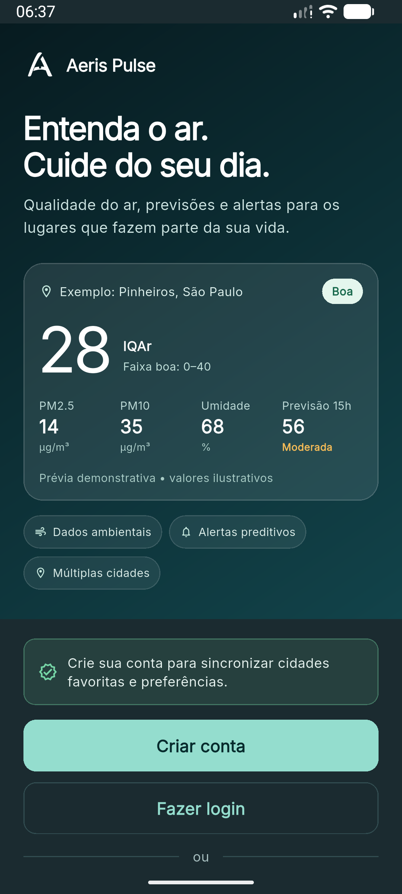 | 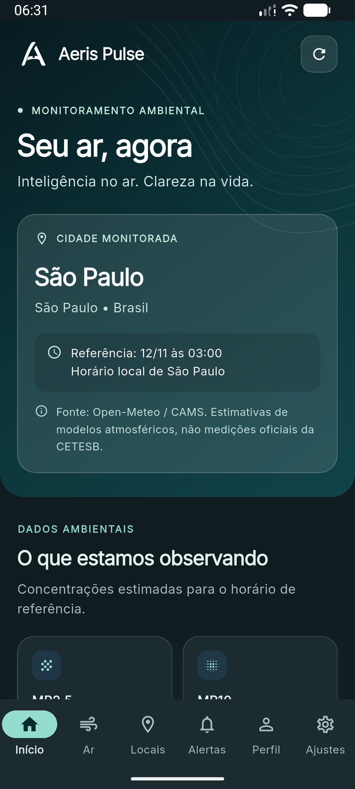 | 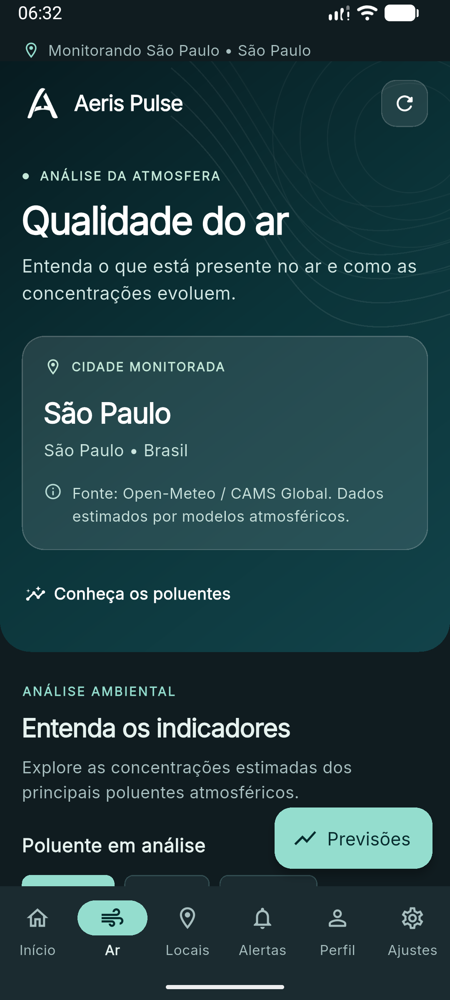 |
| **Análise de poluentes** | **Previsões atmosféricas** | **Alertas ambientais** |
| 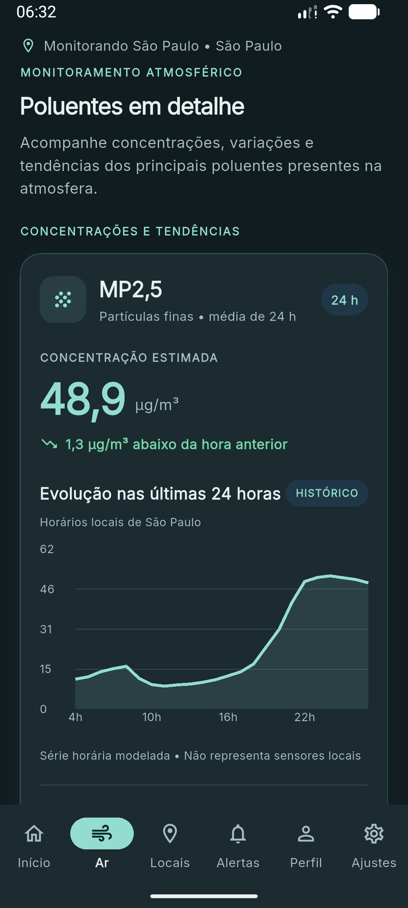 | 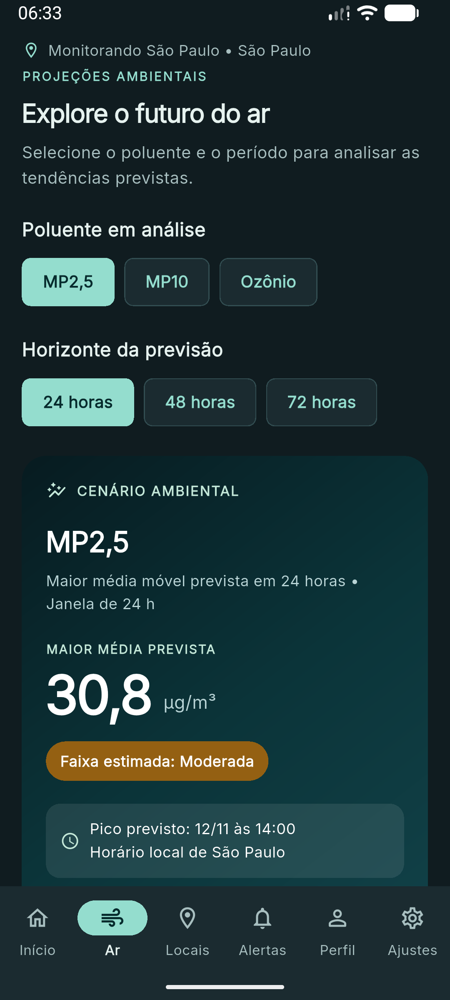 | 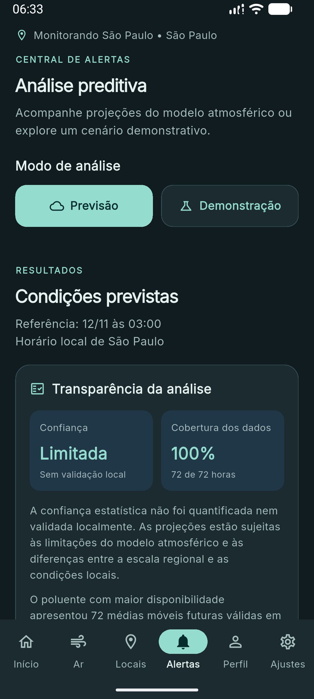 |
| **Cidades e favoritos** | **Login** | **Cadastro** |
| 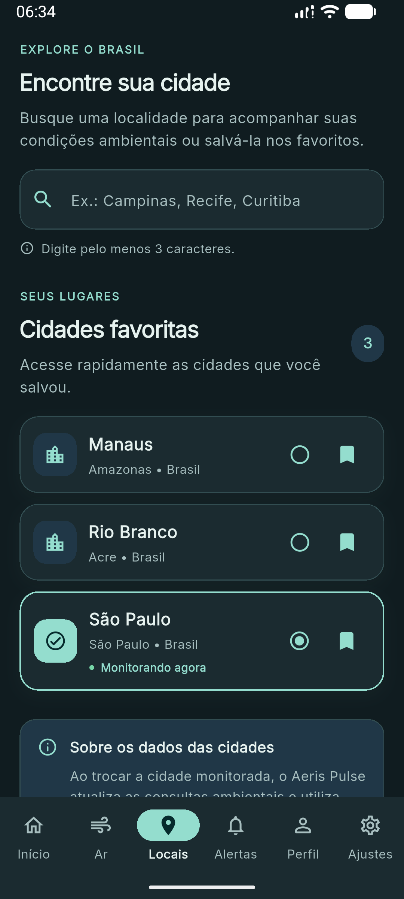 | 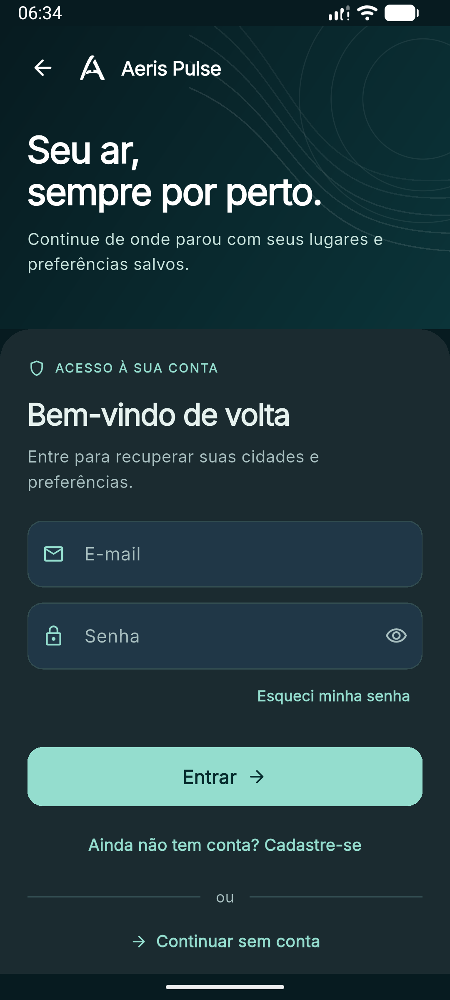 | 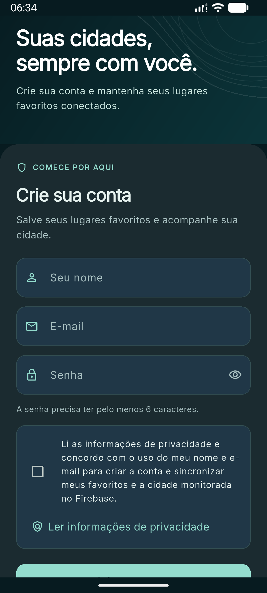 |
| **Minha conta** | **Configurações** | **Privacidade e dados** |
| 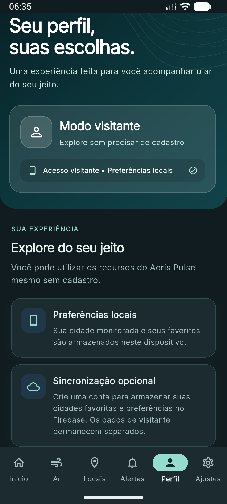 | 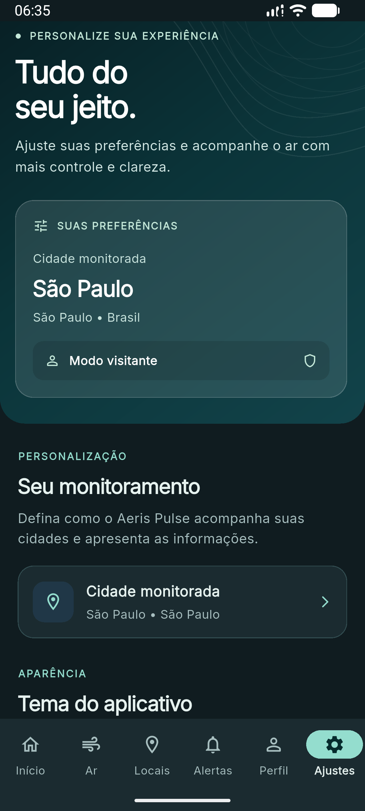 | 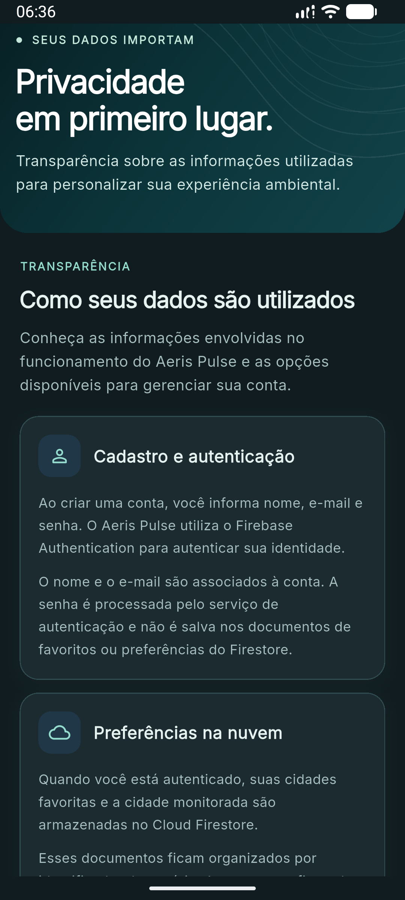 |

---

## Demonstração em vídeo

O vídeo de apresentação demonstra as principais funcionalidades do Aeris Pulse, incluindo navegação, monitoramento ambiental, previsões, alertas e personalização da experiência.

**YouTube:** Link da apresentação a adicionar.

---

## Arquitetura

O projeto utiliza uma organização modular, separando funcionalidades e responsabilidades.

```text
lib/
├── app/
├── core/
│   ├── domain/
│   ├── network/
│   ├── providers/
│   ├── storage/
│   ├── theme/
│   └── widgets/
├── features/
│   ├── air_quality/
│   ├── alerts/
│   ├── auth/
│   ├── forecasts/
│   ├── home/
│   ├── locations/
│   ├── onboarding/
│   └── settings/
└── main.dart
```

As funcionalidades são organizadas em camadas de apresentação, domínio, dados e gerenciamento de estado, conforme as necessidades de cada módulo.

---

## Como executar

### Pré-requisitos

- Flutter SDK instalado.
- Dart SDK.
- Android Studio ou VS Code.
- Emulador Android ou dispositivo físico.
- Projeto Firebase configurado.

### Instalação

Clone o repositório:

```bash
git clone https://github.com/jalbino0/Aeris_Pulse.git
```

Entre na pasta:

```bash
cd Aeris_Pulse
```

Instale as dependências:

```bash
flutter pub get
```

### Configuração do Firebase

Para executar o aplicativo, configure um projeto Firebase com os serviços utilizados pela aplicação.

Os arquivos específicos da configuração Firebase não são disponibilizados neste repositório.

A configuração deve incluir os arquivos necessários à plataforma Android, incluindo:

- `lib/firebase_options.dart`
- `android/app/google-services.json`

A configuração pode ser realizada com o FlutterFire CLI, respeitando as plataformas e os serviços habilitados no projeto.

### Execução

```bash
flutter run
```

---

## Testes e análise

Para verificar a qualidade do código:

```bash
flutter analyze
```

Para executar os testes automatizados:

```bash
flutter test
```

Os testes do projeto abrangem regras de qualidade do ar, análises ambientais, alertas, previsões, armazenamento em cache e outras funcionalidades.

---

## Privacidade e dados

O Aeris Pulse permite utilização sem cadastro.

Para usuários autenticados, determinadas preferências podem ser sincronizadas com o Cloud Firestore.

O aplicativo também utiliza armazenamento local para preferências de visitante e cache ambiental.

O gerenciamento da conta e as informações sobre privacidade estão disponíveis na própria aplicação.

---

## Aviso sobre os dados ambientais

As informações apresentadas pelo Aeris Pulse são baseadas em dados e estimativas disponibilizados por serviços ambientais externos, incluindo Open-Meteo/CAMS.

As estimativas não representam necessariamente medições oficiais de estações de monitoramento, como as da CETESB.

Os alertas e previsões possuem caráter informativo e não substituem orientações de órgãos ambientais ou autoridades competentes.

As notificações locais dependem das permissões do Android e das condições de execução do aplicativo. Sua ativação não implica monitoramento contínuo com o aplicativo fechado.

---

## Equipe de desenvolvimento

| Integrante | RM |
|---|---|
| **João Pedro de Moura Albino** | RM565323 |
| **Kauê Silva Matheus** | RM561675 |
| **Giovanna Fernandes Pereira** | RM565434 |

**Instituição:** FIAP — Faculdade de Informática e Administração Paulista

**Curso:** Ciência da Computação

**Projeto:** Global Solution — 2º semestre de 2026

---

## Repositório

[Aeris Pulse — GitHub](https://github.com/jalbino0/Aeris_Pulse)
